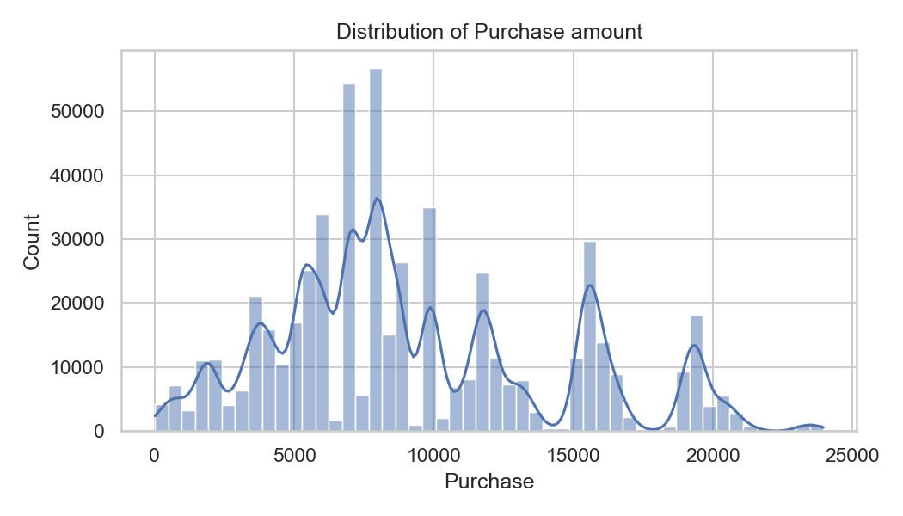
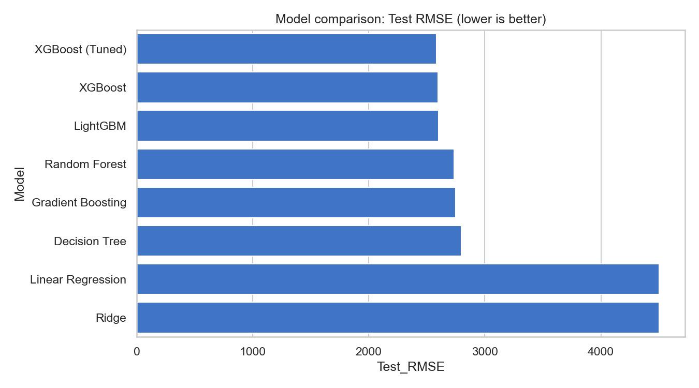
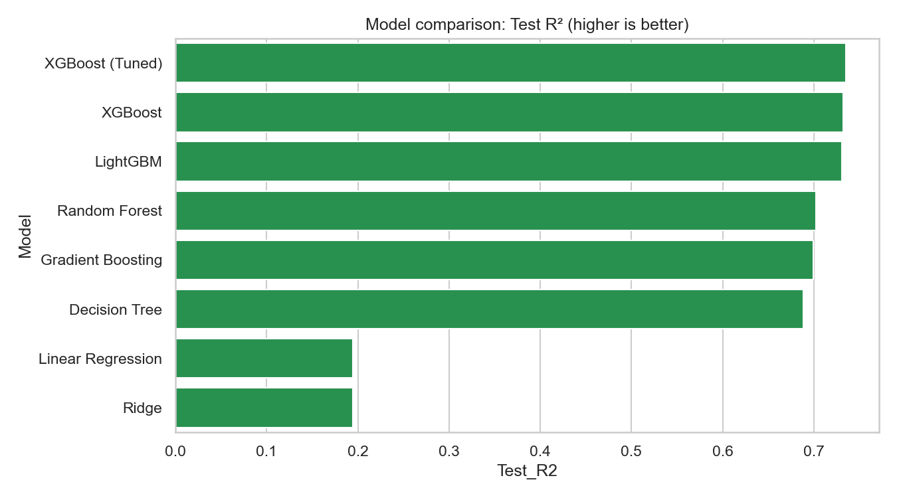
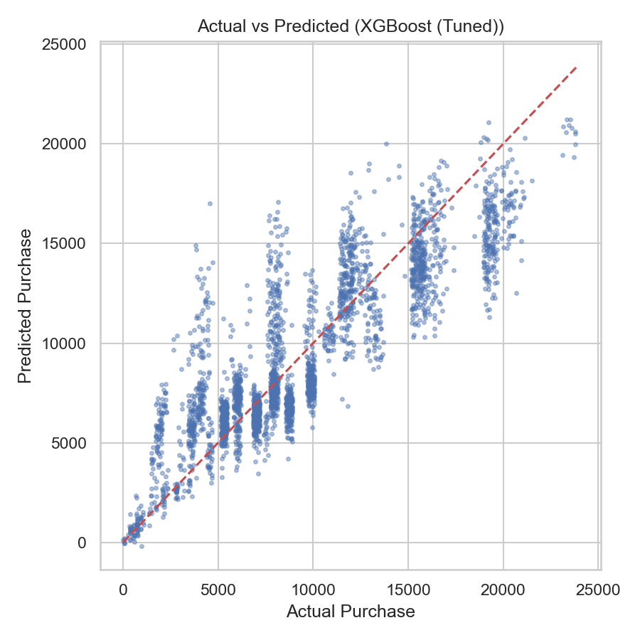
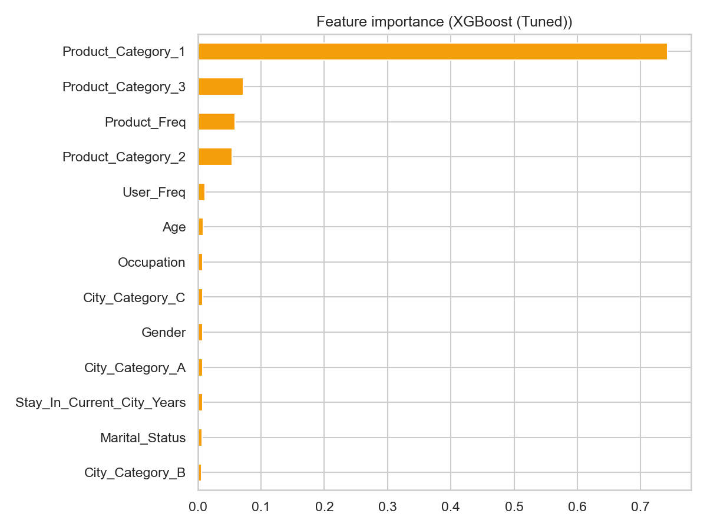

# Consumer Purchase Amount Prediction

**Comparative analysis of predictive learning algorithms for consumer purchase amount prediction in large-scale e-commerce datasets.**

Compares 7 regression algorithms (plus a tuned XGBoost) on 550,068 Black Friday retail transactions to predict the `Purchase` amount, and includes two web apps for live predictions.

## Key findings
- **Tuned XGBoost was best:** R² 0.735, RMSE 2,581, MAE 1,916.
- Boosting models beat Random Forest, a single Decision Tree and the linear models (R² 0.19), so the relationship is non-linear.
- LightGBM matched XGBoost's accuracy while training about twice as fast.

## 1. Dataset
Kaggle "Black Friday" dataset (file `train.csv`, about 550,000 rows): https://www.kaggle.com/datasets/sdolezel/black-friday

`train.csv` is **not included** in this repo. Download it and put it at `data/train.csv`.

Columns: User_ID, Product_ID, Gender, Age, Occupation, City_Category, Stay_In_Current_City_Years, Marital_Status, Product_Category_1/2/3, Purchase

## 2. Setup
```bash
python -m venv venv
venv\Scripts\activate        # Windows
source venv/bin/activate     # Mac/Linux
pip install -r requirements.txt
```

## 3. Run the analysis
```bash
python run.py --demo   # test the setup with synthetic data
python run.py --fast   # real data, no tuning
python run.py          # real data, full run (CV + XGBoost tuning, about 15-30 min)
```

## 4. Results
Method: 80/20 train/test split, 5-fold cross-validation on a 100k-row sample, RandomizedSearchCV for XGBoost.

| Model | Test RMSE | Test MAE | Test R² |
|---|---|---|---|
| **XGBoost (Tuned)** | 2,581 | 1,916 | **0.7348** |
| XGBoost | 2,595 | 1,926 | 0.7320 |
| LightGBM | 2,599 | 1,933 | 0.7311 |
| Random Forest | 2,735 | 2,035 | 0.7022 |
| Gradient Boosting | 2,748 | 2,041 | 0.6995 |
| Decision Tree | 2,799 | 2,079 | 0.6882 |
| Linear / Ridge | 4,500 | 3,452 | 0.1942 |







Full table: `outputs/model_comparison.csv`. Tuned parameters: `outputs/best_xgb_params.json`.

## 5. Web apps
Train and save the final model once:
```bash
python src/train_model.py
```
Then run either app:
```bash
python webapp/app.py            # Flask app with sign-in, dashboard and history -> http://127.0.0.1:5000
python -m streamlit run app.py  # simple Streamlit version -> http://localhost:8501
```
The Flask app has a landing page, register and sign-in, a dashboard, new prediction, prediction history and a model results page. Accounts are stored locally in SQLite with hashed passwords.

## Tech stack
Python, pandas, NumPy, scikit-learn, XGBoost, LightGBM, Matplotlib, Seaborn, Flask, Streamlit

## Project structure
```
run.py            runs the full model comparison
app.py            Streamlit app
src/              preprocessing and training scripts
webapp/           Flask app (templates, static files)
outputs/          results table and charts
models/           saved final model
```

Note: `--demo` uses synthetic data only to check that the code runs. All results above come from the real dataset.